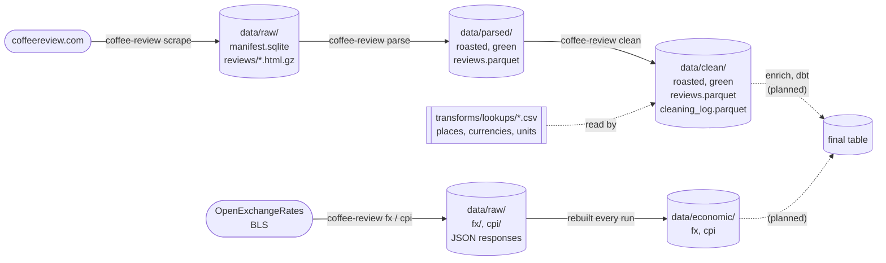
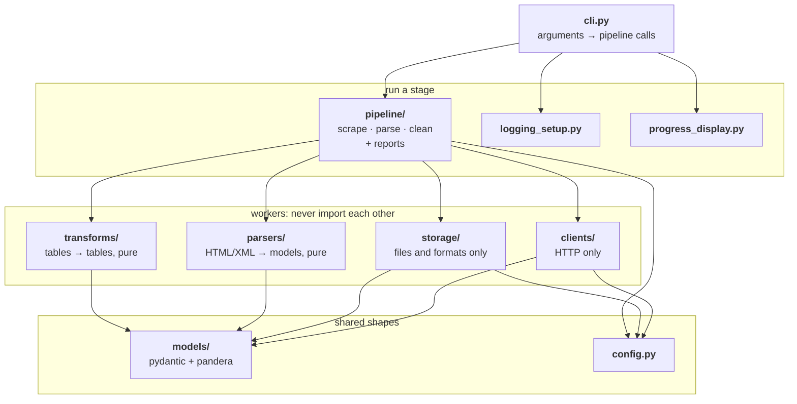
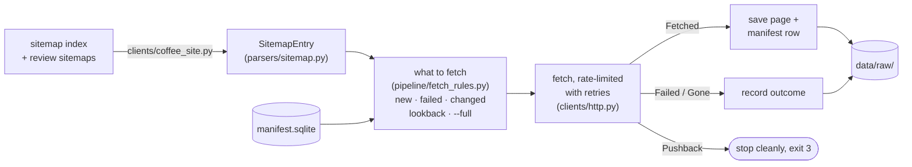
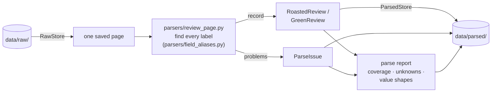
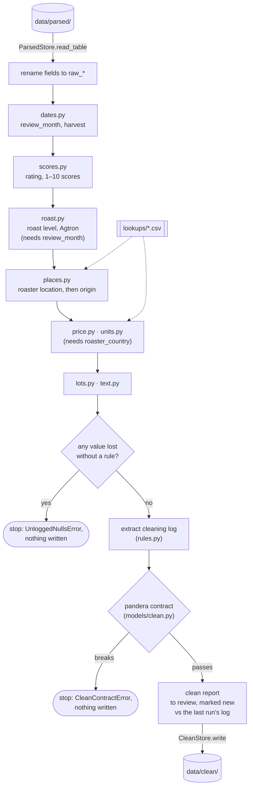
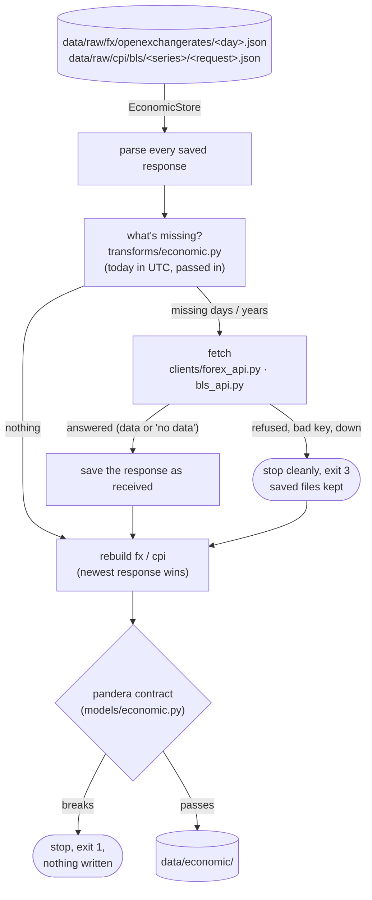
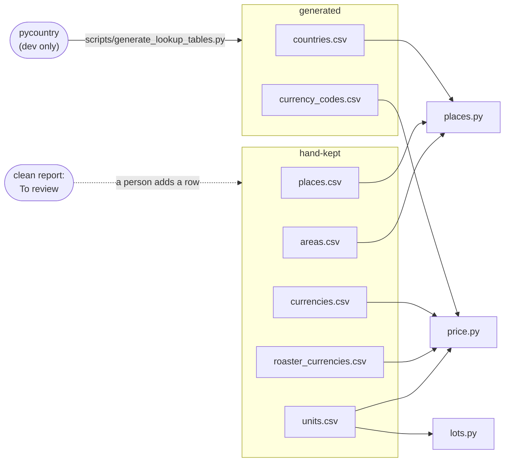

# Architecture

How the code is organised and how data moves through it. The diagrams are
[Mermaid](https://mermaid.js.org/), which GitHub draws in place. Column-level
detail for every table is in the [data dictionary](data-dictionary.md); the
reasons behind the structure are in the [decision records](decisions/).

## The pipeline at a glance

Each stage is one command. It reads one data layer and writes the next, and
never reaches back past the layer it reads.

| Layer | Written by | What it holds | Every run |
|---|---|---|---|
| Raw (bronze) | `scrape` | the HTML as fetched, and a manifest of what was fetched when | adds and refreshes pages (incremental) |
| Parsed | `parse` | one row per review, every value as the page's text | replaced in full (≈6 s) |
| Clean (silver) | `clean` | typed columns, a log of every change, a report | replaced in full (≈1 s) |
| Economic | `fx`, `cpi` | exchange rates and US CPI; the responses they came from in `data/raw/` | fetches only what's missing; tables rebuilt in full |
| Marts (gold) | enrich (planned) | joined to exchange rates and inflation | – |

Each stage also writes a Markdown report next to its data
(`data/parsed/report.md`, `data/clean/report.md`) and a run log under
`data/logs/`.

## The dependency tree

Code is split by what it *does*, and imports only point down. This is the
dependency rule ([ADR 0002](decisions/0002-src-layout-and-dependency-rule.md)),
and it isn't just a convention: two **import-linter** contracts in
`pyproject.toml` check it on every commit and in CI (`uv run lint-imports`).

The two contracts:

1. **Layers.** `cli`, then `pipeline` beside `logging_setup` and
   `progress_display`, then `clients | storage | parsers | transforms`, then
   `models | config`. A module may import from the layers below it, never
   above. Packages on the same layer may not import each other: a parser
   can't reach storage, and a transform can't make an HTTP request.
2. **Pure code does no I/O.** `parsers`, `transforms` and `models` may not
   import `httpx` or `sqlite3`. (Transforms do read their own lookup CSVs,
   which ship with the code, through `importlib.resources`.)

**Only `storage/` knows paths and formats.** The pipeline holds Protocols
(`RawStore`, `ParsedStore`, `CleanStore`) and talks in rows, frames and
models, so a store could move from Parquet to DuckDB by changing one module
and one factory ([ADR 0006](decisions/0006-sqlite-manifest-and-storage-boundary.md)).
Tests run every Protocol against an in-memory fake held to the same contract
tests as the real store.

## Inside each stage

### Scrape

The scraper is incremental: it fetches only what's new, failed, changed, or
due its one re-fetch the day after it appeared. The speed controls (`--rate`,
`--concurrency`) and why are in [ADR 0005](decisions/0005-scrape-speed.md); the
fetch loop is explained step by step in
[explainers/scrape-pipeline.md](explainers/scrape-pipeline.md).

### Parse

Values stay text ([ADR 0007](decisions/0007-parse-text-type-later.md)). One bad
page never stops the run: it becomes a `ParseIssue`.

### Clean

Every transform is `LazyFrame → LazyFrame`. It reads `raw_<field>`, adds typed
columns, and adds `_rule_<field>`, the rules it applied to each row; those
become `cleaning_log.parquet`. Places and prices are parsed once per *distinct*
value in plain Python and joined back. The two checks guard the silver layer:
nothing is written unless every lost value has a rule and both tables meet
their contract ([ADR 0008](decisions/0008-clean-in-polars.md)).

### Economic data

The saved responses are the source of truth; the tables are always rebuilt
from them, so a parser fix needs no requests, and a rerun costs none. Periods a
source will never have, like October 2025's CPI, are saved like any answer and
not asked for again; they're simply absent from the table
([ADR 0009](decisions/0009-keep-raw-economic-responses.md)).

## The lookup tables

The clean stage's interpretation lives in small CSVs, versioned with the code
in `src/coffee_review/transforms/lookups/`. Two are complete lists generated
from ISO standards; the rest are hand-kept and grow from the clean report's
*To review* list.

## Keeping the docs true

- **The data dictionary is generated** from the models
  (`scripts/generate_data_dictionary.py`); a test fails if it's out of date.
  Each column's meaning is the `description` on the field that defines it.
- **The dependency rule is checked** by import-linter on every commit and in CI.
- **This page is hand-written.** Change it when a stage, package or layer
  changes.
