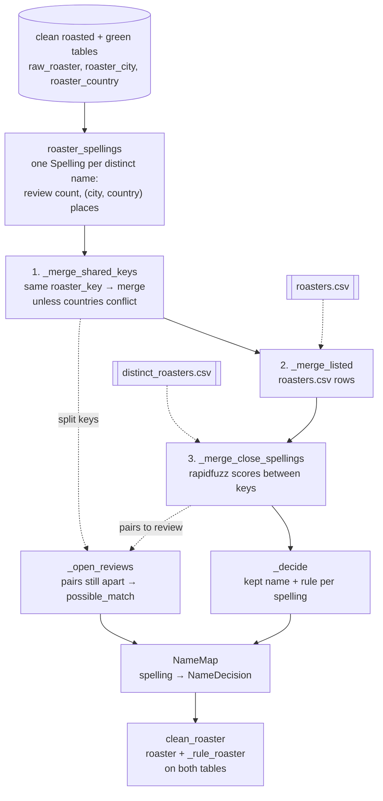

# How roaster names are grouped

A walkthrough of
[`src/coffee_review/transforms/roasters.py`](../../src/coffee_review/transforms/roasters.py):
how the clean stage turns 1,696 roaster spellings into 1,544 roasters, and
how a person's decisions are kept.

## The short version

The same roaster is often written several ways: `JBC Coffee Roasters` and
`JBC`, `El Gran Cafe` and `El Gran Café`, `Lamill Coffee` and
`La Mill Coffee`. Counted as written, one roaster becomes several in the
dashboard and in the models. The clean `roaster` column holds **one name per
roaster**; the cleaning log keeps the name as written.

Every spelling starts as its own group. Three steps merge groups:

| Step | Merges | Unless | Rule logged |
|---|---|---|---|
| 1. Shared key | spellings that differ only in case, accents, punctuation or words like *Coffee Roasters* | their countries don't overlap: then listed for review | `spelling_variant` |
| 2. `roasters.csv` | whatever a person said is one roaster | never: a person looked | `listed_name` |
| 3. Close spellings | keys that score high (`lamill` / `la mill`: 0.92) | the countries conflict, the name is generic, or a person said they're different | `close_spelling` |

Then each group keeps one name, and pairs that couldn't be decided go to the
clean report's *To review* list as `possible_match`. A person settles each one
with a row in a CSV, and it's never asked again.

Only **the same name written differently** is in scope. Roasters that were
renamed, merged or sold are not.

## The flow

The whole map is built once per clean run, from both tables together, so a
green review spelled like a roasted one gets the same name. It takes about
0.03 s.

## The matching key

`roaster_key(name)` ignores everything that never tells two roasters apart:

1. **Case and accents.** The name is casefolded (`ß` → `ss`), Latin letters
   that aren't accented forms are spelled out (`ø` → `o`, `ł` → `l`,
   `æ` → `ae`), and accents are dropped (`é` → `e`).
2. **Punctuation.** `&` becomes `and`, apostrophes go, anything else that
   isn't a letter or digit becomes a space.
3. **Filler words.** `coffee`, `roasters`, `roasting`, `co`, `company`,
   `inc`, `the`, `cafe`, `espresso`, `and` and a few more are dropped (the full
   list is `FILLER_WORDS`).

| Spelling | Key |
|---|---|
| `JBC Coffee Roasters` | `jbc` |
| `JBC` | `jbc` |
| `PT's Coffee Roasting Co.` | `pts` |
| `El Gran Café` | `el gran` |
| `Bird & Bear` | `bird bear` |
| `Großmann Kaffee` | `grossmann kaffee` |

Two edge cases keep unrelated names from sharing a key by accident:

- **A name made only of filler words keeps them all:** `The Coffee Company`
  stays `the coffee company`, not an empty key.
- **A name with no Latin letters or digits is kept whole:** `黑貓咖啡` stays
  `黑貓咖啡`, so two Chinese names never merge just because both lose every
  letter.

The key is checked by property tests: keying a key changes nothing, and case
never matters.

## Where a roaster is

Location is what tells a true match from a false one. A survey of the first
clean found true pairs almost always in the same place, and false ones often
in different countries (`Heat Coffee` in Taipei, `Heart Coffee` in Portland).

Each `Spelling` carries the `(city, country)` pairs of its reviews. Cities
are compared loosely (`normalise_city`: `Taoyuan City` = `Taoyuan`). Green
reviews have no location, which counts as **unknown**: no conflict, but no
support either.

Two groups **conflict** when both have known countries and share none. The
check is always made against each side's **whole group as it is by then**, so
a chain of merges can't join two countries: if `Hearts` (no location) merges
into `Heart Coffee` (US), it can't then pull in `Hearth` (Australia).

## Step 1: spellings that share a key

Within a key, spellings are taken most-reviewed first. Each joins the first
group of its key it doesn't conflict with, or starts a new one. A spelling
with no country never conflicts, so it joins the first (most-reviewed) group.

Usually a key ends as one group. When it ends as several, the key spans
countries that don't overlap, and every smaller group is listed for review
against the largest. On today's data that's cases like:

- `Coffee Alchemy` (Sydney) and `Alchemy` (Lawrence, Kansas);
- `Cafe Sunrise` (Honduras) and `Sunrise Coffee` (San Leandro);
- `San Rafael` (a Guatemalan farm) and `San Rafael Coffee` (Carson City).

## Step 2: `roasters.csv`

A row `spelling,roaster` says *this spelling is that roaster*. It covers every
spelling of its spelling's key **and** of the roaster's key, so
`BB Roasters,Bold Bean` also takes in `Bold Bean`. It merges whatever the
countries say, because a person looked, and the group takes the row's name
even when another spelling has more reviews. The name may be a tidy one that
no review uses.

The rows also fix a kept name. `Jampot Poorock Abbey` had more reviews than
the correct `Jampot Poorrock Abbey`, so the row
`Jampot Poorock Abbey,Jampot Poorrock Abbey` names the group properly.

If two rows would give one roaster two names (through shared spellings), the
run stops with `ConflictingListedNamesError` rather than letting the later row
silently win.

## Step 3: close spellings

Keys of 4 or more characters are compared pairwise with rapidfuzz's
`fuzz.ratio`, taken as a 0–1 score. Pairs are processed best first. For each,
`_outcome` decides from the score and the two groups:

| Score | Countries conflict | No conflict | Same city |
|---|---|---|---|
| ≥ 0.90 (`merge_at`) | review | **merge** | **merge** |
| 0.85–0.90 (`review_at`) | – | review | review |
| 0.80–0.85 (`review_same_city_at`) | – | – | review |
| below 0.80 | – | – | – |

The scores in this table were measured on the real data:

| Pair | Score | Places | Outcome |
|---|---|---|---|
| `Wildgoose` / `Wild Goose` | 0.95 | same | merge |
| `Lamill` / `La Mill` | 0.92 | same | merge |
| `Boyds` / `Boyd` | 0.89 | Portland, both | review |
| `Heat` / `Heart` | 0.89 | Taipei vs Portland | nothing |
| `Hula Daddy` / `Hula Daddy Kona` | 0.80 | Holualoa, both | review |
| `Press` / `Express` | 0.83 | different cities | nothing |

Three more things can stop a merge:

- **A generic name** (only filler words, `The Coffee Roaster`) is never merged
  automatically, only listed: unrelated roasters share such names most often.
- **A `distinct_roasters.csv` row** covering the pair.
- **Two different `roasters.csv` names** on the two groups.

Keys shorter than 4 characters are never compared: one letter's difference
scores high on a short name (`jbc` and `jbd`). Scores are rounded before
they're compared, so a score of exactly a threshold counts (rapidfuzz's own
0–1 cutoff drops a score of exactly 0.8).

The three thresholds are settings: `COFFEE_REVIEW_CLEAN__ROASTER_MERGE_AT`,
`…_REVIEW_AT` and `…_REVIEW_SAME_CITY_AT`, which must stay in order.

## The kept name, and the rule each spelling gets

A group keeps its `roasters.csv` name if it has one, else the spelling with
the most reviews (ties: first alphabetically). Each spelling then gets one
rule, which goes in the cleaning log with the spelling as written:

| The spelling… | Rule |
|---|---|
| is the kept name | none |
| has a key a `roasters.csv` row covers | `listed_name` |
| shares the kept name's key (in a group no row named) | `spelling_variant` |
| joined the group any other way | `close_spelling` |

## The review list

A pair still apart at the end becomes one *To review* item, with
`possible_match`. It goes on the side that **wouldn't keep its name** if the
two merged (fewer reviews; on a tie, later alphabetically), and lists the
names it might be. If a pair was listed last run from the other side, it
isn't marked new again.

Automatic `close_spelling` merges are listed too, so a person can check them.

### Settling an item

The easy way is the **review sheet**, `data/clean/roaster_review.csv`, which
every clean writes. It has one row per pair, with both sides' evidence side by
side, so it opens well in a spreadsheet:

| Column | Example |
|---|---|
| `kind` | `possible_match` (not merged) or `merged` (an automatic merge, to check) |
| `spelling`, `reviews`, `places`, `first`, `last` | `Hula Daddy`, 20, `Holualoa, United States`, 2005-10, 2016-11 |
| `candidate`, `candidate_reviews`, … | `Hula Daddy Kona Coffee`, 47, … |
| `decision` | yours to fill in: `same` or `different` (blank = later) |
| `name` | optional, for `same`: the name to keep (blank = the candidate) |

1. Type `same` or `different` in `decision` for the rows you've decided.
2. Run `coffee-review roasters apply`. It turns each decision into a row of
   the CSVs below, after checking every row (one bad row and nothing is
   written), and skips rows they already have.
3. Run `coffee-review clean`. Decided pairs leave the list.

A decision typed but not yet applied survives a rerun of clean. `same` on a
`merged` row confirms the merge; `different` undoes it.

By hand, the rows `apply` writes are:

| Decision | Row |
|---|---|
| Same roaster | `roasters.csv`: `Hula Daddy,Hula Daddy Kona Coffee` |
| Different roasters | `distinct_roasters.csv`: `Ben's Beans,Dean's Beans` |
| An automatic merge was wrong | `distinct_roasters.csv`: the two spellings |
| The kept name is misspelled | `roasters.csv`: `Jampot Poorock Abbey,Jampot Poorrock Abbey` |

Either way, run `coffee-review clean` afterwards. A distinct row usually keeps two
**keys** apart, so it covers every spelling of each. When both sides share a
key (`Alchemy`, `Coffee Alchemy`), it's about those two spellings only, so a
third `Alchemy` from yet another country is still listed.

The report's *Roaster names* section counts merges by rule and lists any
hand-kept row that does nothing in the current data.

## A worked example

Four spellings, as `roaster_spellings` would build them:

| Spelling | Reviews | Place |
|---|---|---|
| `Hula Daddy Kona Coffee` | 47 | Holualoa, US |
| `Hula Daddy` | 20 | Holualoa, US |
| `La Mill Coffee` | 2 | Los Angeles, US |
| `Lamill Coffee` | 2 | Los Angeles, US |

1. **Keys:** `hula daddy kona`, `hula daddy`, `la mill`, `lamill`. No two
   share one, so step 1 merges nothing.
2. **`roasters.csv`:** empty in this example.
3. **Close spellings:** `la mill` / `lamill` scores 0.92, same city: merged.
   `hula daddy` / `hula daddy kona` scores 0.80, same city: listed for review.
4. **Names:** `La Mill Coffee` and `Lamill Coffee` tie on reviews, so the
   first alphabetically, `La Mill Coffee`, is kept; `Lamill Coffee` gets
   `close_spelling`. `Hula Daddy` (fewer reviews) gets `possible_match`, with
   `Hula Daddy Kona Coffee` as its candidate.

A person reads the report and adds `Hula Daddy,Hula Daddy Kona Coffee` to
`roasters.csv`. On the next run, step 2 merges the two, `Hula Daddy` gets
`listed_name`, and all 67 reviews are under one roaster.

## Where each part is tested

| Behavior | Tests |
|---|---|
| The key: variants, filler-only names, non-Latin names, `ß`/`Ø`, idempotence | `tests/transforms/test_roasters.py`, *The matching key* |
| Every threshold band, the country gate, chains, generic names | `test_roasters.py`, *The name map* |
| `roasters.csv` and `distinct_roasters.csv` rows, conflicts, unused rows | `test_roasters.py` |
| Spellings from the tables, `clean_roaster` | `test_roasters.py`, *From the tables, and back* |
| Both tables in one run, thresholds from settings | `tests/pipeline/test_clean.py` |
| Candidates, new-ness, the *Roaster names* section | `tests/pipeline/test_clean_report.py` |

Why it's built this way (the approaches considered, and the evidence behind
the thresholds) is in the roadmap's M5 entry and
[ADR 0004](../decisions/0004-tooling.md) for rapidfuzz.
