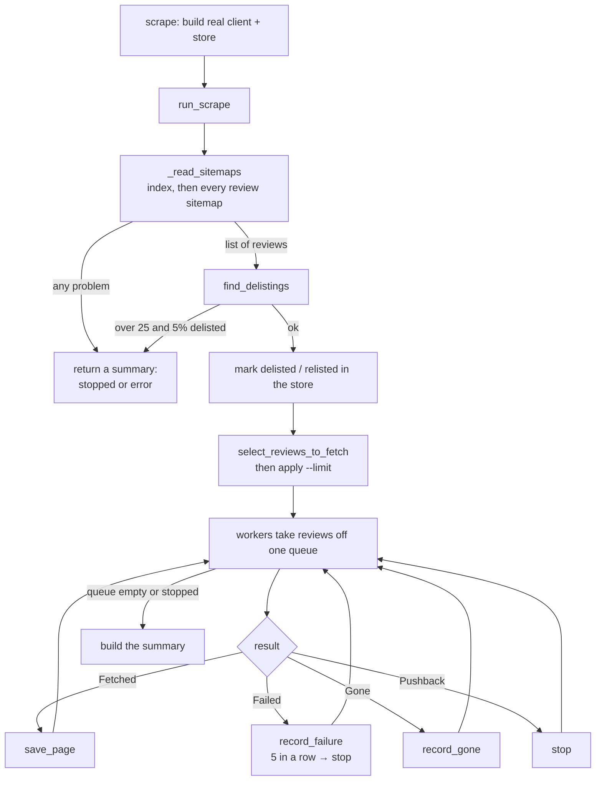

# How a scrape run works

[`pipeline/scrape.py`](../../src/coffee_review/pipeline/scrape.py) runs one
scrape. It does little work of its own: it puts other modules' work in order,
decides when to stop, and sums up the run.

| It asks… | …to do this | Lives in |
|---|---|---|
| `CoffeeScraper` | fetch sitemaps and review pages | `clients/coffee_site.py` |
| the sitemap parser | turn sitemap XML into a list of reviews | `parsers/sitemap.py` |
| the fetch rules | decide which reviews to fetch, and which are delisted | `pipeline/fetch_rules.py` |
| a `RawStore` | save pages and record what happened | `storage/raw_store.py` |

## The flow

`scrape()` builds the real client and store and calls `run_scrape()`, which
tests call directly with fakes.

## The five steps

**1. Read the sitemaps.** The index, then every review sitemap. Any problem (a
failed request, pushback, an index with no review sitemaps) ends the run before
anything is written. `_read_sitemaps` returns either the list of reviews or a
finished summary, rather than raising: a sitemap problem is an expected way
for a run to end, and the CLI wants the same summary line and exit code either
way.

**2. Mark delistings, behind a guard.** `find_delistings` compares the sitemap
with the manifest. If more than 25 reviews **and** more than 5% of the manifest
would be delisted at once, the sitemap is probably broken, so the run refuses
(exit 1) **before** marking anything. The 25 floor stops a few real
delistings blocking a small manifest; `--allow-delisting` overrides the guard.

**3. Choose what to fetch.** `select_reviews_to_fetch` (pure, in
`fetch_rules.py`) picks new, failed, never-fetched and changed reviews, plus
each review's one refetch the day after it appeared, newest first. `--limit`
then caps how many this run tries.

**4. Fetch with a few workers.** `max_concurrency` workers (5 by default)
share one queue. A fixed set of workers, rather than one task per review,
makes stopping simple: each worker checks the stop flag before taking the next
review. They run in an `asyncio.TaskGroup`, so if one crashes (a full disk,
say) the others are cancelled and the error isn't lost.

**5. Sum up.** The summary counts fetched, unchanged, failed, gone and
delisted reviews, and `remaining`: what the queue still held plus what
`--limit` cut off, so it answers "how many still need fetching". `run_scrape`
wraps every way a run ends, so every summary is measured (requests, time,
achieved rate, response time) and logged exactly once, at INFO, WARNING when
stopped, or ERROR.

## When a run stops

Each fetch result gets one action:

| Result | Action |
|---|---|
| `Fetched` | save the page; reset the failure streak |
| `Failed` | record the failure (retried next run); 5 in a row → stop |
| `Gone` (404, 410) | record it, never refetch; the streak is untouched, since dead links aren't pushback |
| `Pushback` (429, 403, a challenge page) | stop; record nothing, so the next run picks the page up again |

**Nothing more is sent once a run is stopped**, not even a retry. Stopping
sets an `asyncio.Event` that every fetch carries into the HTTP client, so a
worker waiting to retry a 500 wakes up, sends nothing and returns `Failed`. A
request already on the wire finishes, and its page is saved. The first reason
to stop is the one reported, even if a second worker hits another one.

Workers share the queue and counters without locks: asyncio switches between
them only at an `await`, so a check, a `popleft()` and the recording of a
result never interleave.

An unexpected error (a locked database, say) is caught around the steps,
logged with its traceback, and still ends in a measured `error` summary and
exit 1. Pages saved before it stay saved.

## A worked example

From `test_pushback_stops_and_next_run_resumes`, with one worker: the sitemap
lists `a`, `b` and `c`, and `b` answers 429.

| Run | What happens | Summary |
|---|---|---|
| First | `a` is fetched and saved; `b` gets a 429, so the run stops before `c` | stopped, 1 fetched, 1 remaining, exit 3 |
| Second | `a` is unchanged; `b` and `c` are new, fetched and saved | finished, 2 fetched, 1 unchanged, exit 0 |

Resuming needs no special code: the second run is an ordinary run, and the
fetch rules skip what's already saved.

## Where each part is tested

In [`tests/pipeline/test_scrape.py`](../../tests/pipeline/test_scrape.py):

| Part | Tests |
|---|---|
| sitemaps | `test_sitemap_failure_marks_nothing_delisted`, `test_sitemap_pushback_stops`, `test_index_without_review_sitemaps_is_error` |
| the delisting guard | `test_delisted_review_marked_and_relisted`, `test_delisting_guard_blocks_mass_delisting` |
| selection and `--limit` | `test_rerun_fetches_no_pages`, `test_changed_review_refetched`, `test_full_refetches_everything`, `test_limit_caps_fetches` |
| stopping | `test_pushback_stops_and_next_run_resumes`, `test_five_failures_in_a_row_stop`, `test_success_resets_failure_streak` |
| gone and failed pages | `test_gone_pages_do_not_stop_and_are_not_refetched`, `test_failed_pages_retried_next_run` |

The fetch rules themselves are tested in `tests/pipeline/test_fetch_rules.py`.
