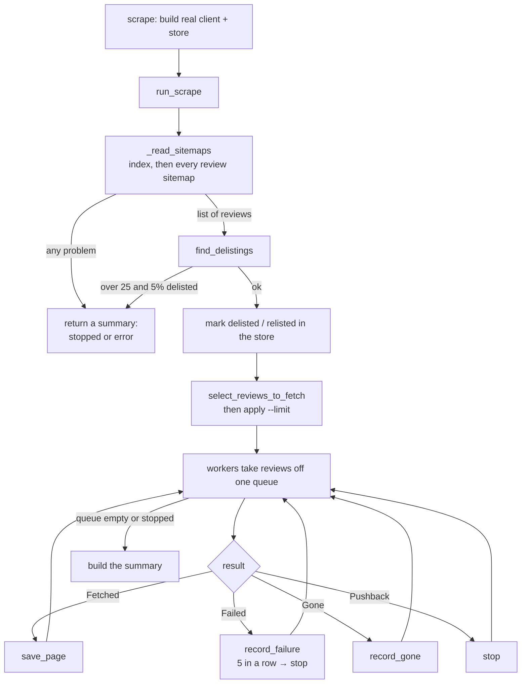

# How `pipeline/scrape.py` works

A walkthrough of [`src/coffee_review/pipeline/scrape.py`](../../src/coffee_review/pipeline/scrape.py),
in the order you'd read it, with the reason each part exists.

## The short version

`scrape.py` runs one scrape. It does no work of its own: it **coordinates**
pieces that live elsewhere.

| It asks… | …to do this | Lives in |
|---|---|---|
| `CoffeeScraper` | fetch sitemaps and review pages | `clients/coffee_site.py` |
| the sitemap parser | turn sitemap XML into a list of reviews | `parsers/sitemap.py` |
| the fetch rules | decide which reviews to fetch, and which are delisted | `pipeline/fetch_rules.py` |
| a `RawStore` | save pages and record what happened | `storage/raw_store.py` |

What `scrape.py` itself owns is the **order** of those steps, the **stop
rules** (pushback, 5 failures in a row), and the **summary** at the end.

## The flow



Every path ends with a `ScrapeSummary`. The CLI turns its `outcome` into an
exit code: `finished` → 0, `error` → 1, `stopped` → 3. (2 is taken by Click
for bad options.)

---

## 1. Imports

```python
from coffee_review.clients.coffee_site import CoffeeScraper, Failed, Fetched, Gone, Pushback
from coffee_review.models import FetchReason, RunMeasurement, ScrapeSummary
from coffee_review.parsers.sitemap import ...
from coffee_review.pipeline.fetch_rules import ...
from coffee_review.storage.raw_store import open_raw_store

if TYPE_CHECKING:
    from collections.abc import Callable
    from datetime import datetime
    from coffee_review.config import Settings
    from coffee_review.models import SitemapEntry
    from coffee_review.storage.raw_store import RawStore
```

**What to notice**

- **The imports follow the dependency rule** in
  [conventions.md](../conventions.md). `pipeline` imports from `clients`,
  `parsers`, `storage` and `models`, and nothing imports `pipeline` except the CLI.
- **The `if TYPE_CHECKING:` block is only for type hints.** It holds names
  used *only* in annotations. They're never imported when the program runs,
  only when mypy checks it. Ruff's `TC` rules move imports here automatically.
- **The only thing imported from storage at runtime is `open_raw_store`.**
  `RawStore` is used only as a type. There's no `sqlite3`, `gzip` or `Path`
  anywhere in the file: that's the storage boundary in practice.

## 2. `MAX_CONSECUTIVE_FAILURES = 5`

**What it is:** a named constant for the "5 failures in a row" stop rule.

**Why it exists:** a bare `5` deep in the code is a magic number. A name says
what the number is for, and tests and messages can refer to it.

## 3. `scrape()`: the composition root

```python
def scrape(settings, *, full, limit, now) -> ScrapeSummary:
    async def main() -> ScrapeSummary:
        store = open_raw_store(settings)
        try:
            async with CoffeeScraper(settings.coffee_site) as client:
                return await run_scrape(settings, client=client, store=store, ...)
        finally:
            store.close()

    return asyncio.run(main())
```

**What it does:** it builds the *real* client and store, runs the scrape, and
cleans up afterwards. The CLI calls this function.

**Why it's separate from `run_scrape`:** this is the one piece of code that
decides *which* client and store are used. Everything else gets them passed
in. Passing dependencies in like this is called **dependency injection**, and
it's why the tests can hand `run_scrape` a `FakeSite` and an
`InMemoryRawStore` instead.

The place where the real objects are built is called the **composition
root**. Keeping it small and separate means that swapping the storage, as you
asked for, is a change to `open_raw_store` alone.

**The pieces**

- **`asyncio.run(main())`**: the HTTP client is async, so something has to
  start an event loop. `asyncio.run` does that, runs `main()` to completion,
  and closes the loop. It's called once, here, so the CLI can stay ordinary
  synchronous code.
- **The nested `async def main()`**: the setup and cleanup need `await` and
  `async with`, which only work inside an `async` function. `main` is that
  function. It's nested because nothing else needs it.
- **`async with CoffeeScraper(...) as client`**: this opens the HTTP
  connection pool on entry and closes it on exit, even if an error happens.
- **`try: ... finally: store.close()`**: this closes the SQLite connection
  however the run ends, whether it returns normally or something raises.

## 4. `run_scrape()` and `_scrape_steps()`: measure, then the five steps

`run_scrape` is a thin wrapper that measures the run (ADR 0005):

```python
started = clock()
requests_before = client.stats.requests
summary = await _scrape_steps(...)
measured = summary.model_copy(update={"measurement": RunMeasurement(...)})
```

- **What it measures:** the number of requests sent (sitemaps, pages and
  retries; the client counts every attempt), how long the run took, the
  average response time, and the rate and concurrency used.
- **Why a wrapper:** every way a run can end, early or not, passes through
  this one place, so every summary gets measured and logged exactly once.
- **Why the counts are "before" and "after" differences:** if the same
  client is used for two runs, each summary still counts only its own
  requests.
- **Why `clock` is passed in** (it defaults to `time.monotonic`): tests can
  control the elapsed time, the same way they control `now`. A monotonic
  clock never jumps backwards, even if the system time changes, so it's the
  right kind for measuring how long something took.

`_scrape_steps` does the actual work. Each step below matches a block in it.

### Step 1: read the sitemaps

```python
listing = await _read_sitemaps(client, str(settings.coffee_site.sitemap_url))
if isinstance(listing, ScrapeSummary):
    return listing   # run_scrape measures and logs it
entries = listing
```

**The return type:** `_read_sitemaps` returns *either* the list of reviews *or*
a finished summary explaining why it couldn't, written as
`list[SitemapEntry] | ScrapeSummary`.

**The check:** `isinstance` asks which one came back. After that check, mypy
knows `listing` is the list, which is what the `entries = listing` line
relies on.

**Why return a summary instead of raising an exception:** a sitemap problem
isn't a bug. It's an expected way for a run to end, and the CLI needs the same
summary line and exit code either way. Raising would work too, but then the
CLI would have to catch several exception types and rebuild the summary from
them.

### Step 2: delisting, with the guard

```python
manifest = store.load_manifest()
delistings = find_delistings(entries, manifest)
if delisting_exceeds_limit(delistings, len(manifest)):
    ... return an "error" summary, marking nothing
store.mark_delisted(delistings.delisted, now)
store.mark_relisted(delistings.relisted)
```

**What happens:**

1. The manifest is loaded once.
2. The pure function `find_delistings` compares it with the sitemap.
3. The guard checks the size of the change before anything is written.

**Why the guard comes before the writes:** if the sitemap is broken (for
example, half empty), we want to refuse *before* marking hundreds of reviews
as delisted. Afterwards would be too late.

**When it trips:** only when more than 25 reviews **and** more than 5% of the
manifest would be delisted at once. The floor means a small manifest isn't
blocked by a few real delistings. If a big delisting is real,
`--allow-delisting` marks them anyway and logs a warning.

**When something unexpected breaks the run** (the disk fills up, the database
is locked), `run_scrape` catches it around `_scrape_steps`. It logs the full
traceback, and still returns a measured `error` summary, so the run ends with
its summary line and exit 1. Pages saved before the error stay saved. Ctrl-C
isn't caught: it stops the program as normal.

**Why the same `manifest` is used again in step 3:** the delisting marks
don't affect which reviews get fetched, so there's no need to reload it.

### Step 3: choose what to fetch

```python
selected = select_reviews_to_fetch(entries, manifest, now=now, full=full)
planned = selected[:limit] if limit is not None else selected
```

**`selected`** is every review the rules say to fetch, newest first.
**`planned`** is the subset this run will actually try. With `--limit 20`,
it's the first 20.

Both lists are kept because the summary needs both of them (see step 5).

### Step 4: fetch with workers

```python
run = _FetchRun(store=store, now=now, queue=deque(planned))
async with asyncio.TaskGroup() as workers:
    for _ in range(settings.coffee_site.max_concurrency):
        workers.create_task(run.work(client))
```

**What happens:** this starts `max_concurrency` workers (5 by default, worked
out from `--rate`; see ADR 0005), and
they share one queue. The `async with` block doesn't end until every worker
has finished.

**Why workers and a queue:** the alternative is to start one task per review,
which would be 9,400 tasks at once on a full run. The client's limits would
still keep the request rate polite, but there'd be no clean way to say "stop
starting new requests". With a fixed number of workers, each one checks the
stop flag before taking the next review, so stopping is a single `if`.

**Why `TaskGroup`:** it's the modern way (Python 3.11+) to run tasks together
and wait for all of them. If one worker raises, for example on a disk error,
the TaskGroup cancels the others and the error propagates. A crash never goes
unnoticed while the other worker keeps running.

### Step 5: the summary

```python
summary = ScrapeSummary(
    outcome="stopped" if run.stopped_reason else "finished",
    fetched=dict(run.fetched),
    unchanged=len(entries) - len(selected),
    ...
    remaining=len(run.queue) + len(selected) - len(planned),
    ...
)
```

**The arithmetic, with an example.** Say the sitemap lists 9,400 reviews and
100 of them need fetching. You ran with `--limit 20`, and pushback stopped the
run after 12 attempts.

| Field | Formula | Value |
|---|---|---|
| `unchanged` | `len(entries) - len(selected)` | 9,400 − 100 = 9,300 |
| `remaining` | what's still in the queue + what `--limit` cut off | 8 + (100 − 20) = 88 |

So `remaining` answers "how many still need fetching", counting both the
reviews this run didn't get to and the ones it was never going to try.

**The log level:** `run_scrape` logs the measured summary at INFO when the run
finished, WARNING when it stopped and ERROR when it ended in an error, so
problem runs stand out in the log.

## 5. `_read_sitemaps()`: all or nothing

```python
try:
    index = await _fetch_sitemap_text(client, index_url)
    if isinstance(index, ScrapeSummary): return index
    sitemap_urls = parse_sitemap_index(index)
    if not sitemap_urls: return _ended_early("error", ...)
    for url in sitemap_urls:
        text = await _fetch_sitemap_text(client, url)
        if isinstance(text, ScrapeSummary): return text
        entries.extend(parse_review_sitemap(text))
except SitemapParseError as exc:
    return _ended_early("error", str(exc))
return dedupe_entries(entries)
```

**What it does:** it fetches the index, then each review sitemap, one after
another. The result is either the complete list of reviews or a summary.

**Why it's all or nothing:** if sitemap 7 of 10 failed and we carried on,
about 1,000 reviews would be missing from the list. Step 2 would then see them
as delisted. A partial list is worse than no list at all, so any problem here
ends the run before anything is fetched or marked.

**Why "no review sitemaps" counts as an error:** the index downloading fine
but listing no review sitemaps most likely means the site changed its
structure. It doesn't mean every review was deleted.

**Why `dedupe_entries` at the end:** the same slug can show up in two
sitemaps. Deduping keeps one entry per slug, the one with the newest lastmod,
so no review is fetched twice.

## 6. `_fetch_sitemap_text()`: `match` on the result

```python
match await client.fetch_sitemap(url):
    case Fetched(text=text):
        return text
    case Pushback(reason=reason):
        return _ended_early("stopped", f"{reason} at {url}")
    case Failed(error=reason) | Gone(reason=reason):
        return _ended_early("error", f"sitemap {url}: {reason}")
```

**What it does:** it turns one of the four fetch results into either text or a
summary.

**How `match` works here** (structural pattern matching, Python 3.10+):

- **`case Fetched(text=text):`** means "if the result is a `Fetched`, take its
  `text` field into a variable called `text`". One line does the type check
  and the field access.
- **`case Failed(error=reason) | Gone(reason=reason):`** is an *or-pattern*. A
  `Failed` and a `Gone` mean the same thing for a sitemap (an error), so they
  share one branch. Both sides bind the same name, `reason`.
- **mypy checks exhaustiveness.** Because `FetchResult` is exactly these four
  types, mypy knows every case is covered. If a fifth result type were ever
  added, the missing return would be flagged.

**Why sitemaps get their own handling:** for a review *page*, `Gone` is
normal: we record it and carry on. For a *sitemap*, any non-success is fatal,
for the all-or-nothing reason in section 5.

## 7. `_ended_early()`

**What it does:** it builds a summary for a run that never got as far as
fetching pages: every count is zero, and the reason is filled in.

**Why it exists:** it's needed in five places. Without it, each of those
places would repeat nine fields, and it would be easy to get one wrong.

**The `outcome` type:** it's `Literal["stopped", "error"]`. A run that ended
early can't be `finished`, and the type makes that impossible to get wrong.

## 8. `_FetchRun`: the state the workers share

```python
@dataclass
class _FetchRun:
    store: RawStore
    now: datetime
    queue: deque[tuple[SitemapEntry, FetchReason]]
    fetched: Counter[FetchReason] = field(default_factory=Counter)
    failed: int = 0
    gone_slugs: list[str] = field(default_factory=list)
    consecutive_failures: int = 0
    stopped_reason: str | None = None
```

**What it is:** everything the workers need to share during one run: the
queue, the counters, and the stop flag.

**Why it's a class:** the conventions say to use classes only where there's
state to hold, and this is that kind of state. The alternatives would be
globals (shared between runs, and a source of bugs) or passing six values
into every worker. Here, one object holds the state for one run, and it's
thrown away when the run ends.

**Why it's a dataclass:** `@dataclass` writes the `__init__` for you from
the fields listed.

**Why `field(default_factory=Counter)`:** a mutable default like `[]` or
`Counter()` would be **shared by every instance**, which is a classic Python
pitfall. `default_factory` creates a fresh one for each run.

**Why the leading underscore:** it marks the class as private to this module.
Nothing else should build one.

**The types used:**

- **`deque`**: a double-ended queue. Its `popleft()` is fast, where
  `list.pop(0)` gets slower as the list grows.
- **`Counter`**: a dict that counts. `self.fetched[reason] += 1` works even
  the first time a reason is seen, with no `KeyError`.

## 9. `work()`: the worker loop

```python
async def work(self, client):
    while self.queue and self.stopped_reason is None:
        entry, reason = self.queue.popleft()
        self._record(entry, reason, await client.fetch_review_page(entry))
```

**What it does:** each worker runs this loop. It keeps taking reviews until
the queue is empty or someone has set a stop.

**How two workers share state safely.** asyncio runs on **one thread**, and
it only switches between workers at an `await`. In this loop, that's the
`await client.fetch_review_page(...)`.

- **Between awaits, nothing interleaves.** The check, the `popleft()` and
  `_record()` all run without the other worker in between, so no locks are
  needed.
- **Threads would be different.** Two threads could both pass the `while`
  check and pop at the same time, which is why threaded code needs locks.

**What "stop" means in practice**, with 2 workers:

1. Worker A gets a 429 and sets `stopped_reason`.
2. Worker B may still be waiting on its own request. When that returns, its
   result is still recorded: the page is saved.
3. Worker B's next `while` check sees the stop, and it exits.

The rule is that **nothing more is sent once the run is stopped**: no new
review, and no retry either. `_stop` also sets `stop_signal`, an
`asyncio.Event` that every page fetch carries into the HTTP client. If worker
B was backing off before retrying a 500, the client sees the signal, ends the
wait early, sends nothing, and returns `Failed`, so the page is retried next
run. Only a request that's already on the wire finishes, and its result is
saved.

(An earlier version stopped only *new* reviews, so a worker in the middle of
retries kept sending them. The final review caught it; with 5 workers that
could have been about 20 requests after a 429.)

## 10. `_record()`: one result, one action

```python
match result:
    case Fetched(text=html):    save_page(...);      count it; reset the failure streak
    case Failed(error=error):   record_failure(...); streak += 1; 5 in a row → stop
    case Gone(reason=...):      record_gone(...);    remember the slug (the streak is untouched)
    case Pushback(reason=..., url=url): stop
```

**What it does:** it acts on one fetch result. Each branch matches one row of
the design doc's decisions.

**`lookback=reason is FetchReason.LOOKBACK`** tells the store whether this
save was the one-time lookback refetch. If it was, `lookback_done` becomes
true; any other save resets it. `is` works here because each enum member is a
single object.

**Why `Gone` doesn't touch the streak:** a run of 404s means dead links, not
the site pushing back. That's the decision you made.

**Why `Pushback` records nothing in the store:** the page wasn't fetched and
didn't fail on its own, so its manifest row stays as it was. The next run then
picks it up again with its original reason.

## 11. `_stop()`: the first reason wins

```python
def _stop(self, reason):
    if self.stopped_reason is None:
        logger.warning("stopping: %s", reason)
        self.stopped_reason = reason
```

**What it does:** it records why the run stopped.

**Why it checks first:** with 2 workers, both could hit a stop condition, for
example one gets a 429 while the other's 5th failure lands. The summary should
report what stopped the run first, not whatever came last.

---

## A worked example

This is the scenario from `test_pushback_stops_and_next_run_resumes`, with one
worker. The sitemap lists reviews `a`, `b` and `c`, newest first, and `b`
answers 429.

| | What happens | State afterwards |
|---|---|---|
| **First run** | Sitemaps read: 3 entries. The manifest is empty, so nothing is delisted. | |
| | `select_reviews_to_fetch` returns `[a, b, c]`, all `NEW`. | queue: a, b, c |
| | The worker takes `a`, which comes back `Fetched`, and `save_page(a)` runs. | queue: b, c |
| | The worker takes `b`, which comes back `Pushback("HTTP 429")`, and `_stop` runs. | queue: c; stopped |
| | The loop check sees the stop and the worker exits. | |
| | Summary: `stopped`, 1 fetched, remaining = 1 (`c`), exit code 3. | |
| **Second run** | The manifest has only `a`. | |
| | The rules select `b` and `c` (both `NEW`); `a` is unchanged. | queue: b, c |
| | Both come back `Fetched` and are saved. | |
| | Summary: `finished`, 2 fetched, 1 unchanged, exit code 0. | |

Resuming needs no special code: the second run is an ordinary run, and the
rerun rules skip what's already saved.

## Where each part is tested

| Part | Tests |
|---|---|
| sitemap handling (sections 5–6) | `test_sitemap_failure_marks_nothing_delisted`, `test_sitemap_pushback_stops`, `test_index_without_review_sitemaps_is_error` |
| delisting guard (step 2) | `test_delisted_review_marked_and_relisted`, `test_delisting_guard_blocks_mass_delisting` |
| selection and limit (step 3) | `test_rerun_fetches_no_pages`, `test_changed_review_refetched`, `test_full_refetches_everything`, `test_limit_caps_fetches` |
| stop rules (sections 9–11) | `test_pushback_stops_and_next_run_resumes`, `test_five_failures_in_a_row_stop`, `test_success_resets_failure_streak` |
| gone and failed pages (section 10) | `test_gone_pages_do_not_stop_and_are_not_refetched`, `test_failed_pages_retried_next_run` |

All of these are in [`tests/pipeline/test_scrape.py`](../../tests/pipeline/test_scrape.py).
The rules themselves are tested separately in `test_fetch_rules.py`.
